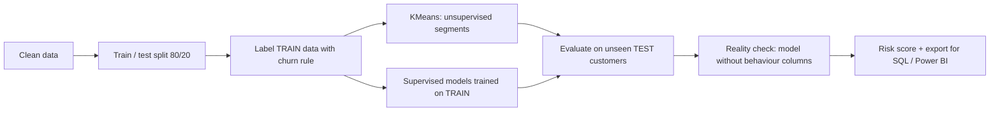

# ChurnLens: Customer Churn & Retention Analytics


An end-to-end customer analytics project on **3,900 retail customers**: data cleaning in Python, **churn modelling with machine learning** (supervised + unsupervised), **SQL business analysis**, and a **Power BI dashboard**.

> **Workflow:** Data Cleaning → Feature Engineering → Churn Labelling → Machine Learning → SQL Analysis → Power BI → Business Insights

<!-- Add a dashboard screenshot here:  -->

---

## Table of Contents
- [Project Highlights](#project-highlights)
- [Business Problem](#business-problem)
- [Dataset](#dataset)
- [How Churn Is Defined](#how-churn-is-defined)
- [Machine Learning Approach](#machine-learning-approach)
- [Key Findings](#key-findings)
- [SQL Analysis](#sql-analysis)
- [Power BI Dashboard](#power-bi-dashboard)
- [Repository Structure](#repository-structure)
- [How to Run](#how-to-run)
- [Limitations & Next Steps](#limitations--next-steps)
- [Tech Stack](#tech-stack)
- [Author](#author)

---

## Project Highlights

| | |
|---|---|
| **Customers analysed** | 3,900 |
| **Customers flagged as churned (at-risk)** | 870 (22.3%) |
| **Revenue at risk** | $52,020 of $233,081 (22.3%) |
| **ML split** | 3,120 train / 780 held-out test customers |
| **Models compared** | Logistic Regression, Decision Tree, Random Forest, Gradient Boosting, KMeans |
| **SQL queries** | 60+ across validation, customer, subscription, churn and business-insight scripts |
| **Leakage check** | Included, showing what the model can and cannot predict (see [Key Findings](#key-findings)) |

---

## Business Problem

Retail teams collect large volumes of transaction data but rarely turn it into retention decisions. This project answers questions such as:

- How many customers are disengaging, and how much revenue do they represent?
- Can a machine learning model flag at-risk customers automatically?
- Which customers should be contacted first (high value, recently lapsed, still happy)?
- Do demographics, product, payment or shipping choices explain who churns?
- Which categories, seasons and customer segments drive revenue?

---

## Dataset

**3,900 customer purchase records, 19 original attributes** (one row per customer): demographics, product and category, purchase amount, location, review rating, subscription status, shipping type, discount usage, previous purchases, payment method and purchase frequency.

The churn notebook adds **8 columns**, giving the final 27-column file `customer_shopping_churn_scored.csv`:

| Column | Meaning |
|---|---|
| `churn_flag` | 1 = churned (at-risk), 0 = retained |
| `split` | `train` or `test` (side of the ML split) |
| `risk_segment` | Low / Medium / High engagement risk |
| `engagement_risk_score` | 0–100, higher = more at risk |
| `ml_churn_probability` | Model probability (train rows: out-of-fold, test rows: held-out) |
| `ml_churn_prediction` | 1 if probability ≥ 0.5 |
| `kmeans_cluster` | Unsupervised customer segment (0–3) |
| `kmeans_at_risk` | 1 if the customer is in the at-risk KMeans cluster |

---

## How Churn Is Defined

The dataset has **no churn label and no purchase dates**, so real churn (cancellations, lapses over time) cannot be observed. Churn is therefore defined as a **behavioural proxy**:

> A customer is **churned (at-risk)** if they buy **every 90+ days** *and* have **25 or fewer previous purchases** (the training-set median).

Read "churn" in this project as **"disengaged / at risk of lapsing"**. The two thresholds are set in one cell of the notebook and can be changed.

---

## Machine Learning Approach

Notebook: [`Notebooks/Customer_shopping_churn.ipynb`](Notebooks/Customer_shopping_churn.ipynb)



1. **Split first.** The data is split 80/20 *before* any labelling, so test customers are never seen in training.
2. **Label the training data** with the churn rule. Thresholds are learned from the training set only and applied unchanged to the test set. Test labels are used only for scoring.
3. **Unsupervised learning (KMeans, k = 4)** clusters customers on purchase interval and previous purchases with no labels, then picks the at-risk cluster without using the churn label.
4. **Supervised learning.** Logistic Regression, Decision Tree, Random Forest and Gradient Boosting are compared with 5-fold cross-validation on the training set. Ties are broken by choosing the simplest model (Decision Tree).
5. **Reality check.** The same pipeline is run *without* the behavioural columns that define churn, to test whether anything else predicts it.
6. **Engagement risk score** (0–100): a transparent rule-based score from purchase interval (50%), previous purchases (30%) and review rating (20%), used for dashboard segments.

### Results on the 780 held-out test customers

| Model | ROC-AUC | F1 |
|---|---|---|
| No-skill baseline | 0.50 | 0.00 |
| Logistic Regression | 0.90 | 0.65 |
| **Decision Tree (chosen)** | **1.00** | **1.00** |
| Random Forest | 1.00 | 1.00 |
| Gradient Boosting | 1.00 | 1.00 |
| KMeans at-risk cluster (no labels) | n/a | precision 0.98, recall 1.00 |

---

## Key Findings

### Churn findings

1. **22.3% of customers (870) are flagged as churned**, representing **$52,020 (22.3%) of revenue**.
2. **The High-risk segment is 775 customers (about 20%) with an 80% churn rate**, holding **19.7% of revenue**. The Medium segment has a 21% rate and the Low segment 0%. These rates follow by construction, because the score and the churn rule use the same signals.
3. **A depth-2 decision tree recovers the churn rule exactly** (more than 60 days between purchases and 25 or fewer previous purchases).
4. **No customer segment stands out.** Churn rates by subscription, category, gender, shipping, payment, season, discount and rating all sit within a few points of the 22% average. Age group looks borderline (p = 0.046), which is expected by chance across 10 tests and does not hold on the full dataset (p ≈ 0.10).

### Why the near-perfect model scores need context

The label is built from purchase interval and previous purchases, and those columns are also model inputs, so the models re-learn the rule. That is expected, and it makes the model a working, auditable **churn-flag classifier** for scoring new customers. It is **not** evidence of forecasting future churn from independent signals.

The reality-check step shows this directly. With the two label-defining columns removed, every model drops to a **test ROC-AUC of about 0.51**, which is a coin flip. Demographics, product, payment, shipping, subscription, discount, rating and order value carry no usable information about who disengages. Forecasting real churn would need dated transactions or an observed churn outcome.

### Revenue and customer findings

| Finding | Detail |
|---|---|
| Male customers generate most revenue | $157.9K (67.7%) vs $75.2K from female customers |
| Non-subscribers generate more total revenue | $170.4K vs $62.6K, but average spend is almost identical ($59.87 vs $59.49) |
| Clothing is the largest category | $104.3K (44.7% of revenue), then Accessories $74.2K |
| Fall is the top season | $60.0K, with Summer lowest at $55.8K |
| Young adults lead age-group revenue | $62.1K, with all four groups within about 11% of each other |
| Payment and shipping are evenly spread | PayPal (677), Credit Card (671) and Cash (670) are nearly tied; Free Shipping is the top shipping type (675) |
| Loyal customers drive most revenue | 2,339 customers with more than 20 previous purchases contribute $139.6K (60%) |

---

## SQL Analysis

All scripts are in [`SQL/`](SQL/) and run against a table named `customer_shopping_analysis` (import `customer_shopping_churn_scored.csv`). They use standard aggregation, `GROUP BY`, `CASE WHEN`, subqueries and `LIMIT`.

| File | Focus |
|---|---|
| `01_Data_Validation.sql` | Row count, duplicate IDs, missing values |
| `02_Customer_Analysis.sql` | Gender and age-group distribution, average age |
| `03_Subscription_Analysis.sql` | Subscribers vs non-subscribers: customers, revenue, rating |
| `04_Churn_Analysis.sql` | Churn rate, revenue at risk, churned vs retained, churn by segment, customer type and rating, win-back and early-warning lists, ML and KMeans checks |
| `06_Business_insights.sql` | Revenue by gender, season, state, age group, category; top products; discounts; repeat buyers; top spenders |

**Example: early-warning list, high-risk customers who have not churned yet**

```sql
SELECT customer_id, category, purchase_amount, frequency_of_purchases,
       previous_purchases, engagement_risk_score
FROM customer_shopping_analysis
WHERE risk_segment = 'High'
  AND churn_flag = 0
ORDER BY engagement_risk_score DESC
LIMIT 20;
```

**Example: churn rate by customer type**

```sql
SELECT CASE
           WHEN previous_purchases <= 5 THEN 'New'
           WHEN previous_purchases <= 20 THEN 'Returning'
           ELSE 'Loyal'
       END AS customer_type,
       COUNT(*) AS customers,
       SUM(churn_flag) AS churned,
       ROUND(100.0 * SUM(churn_flag) / COUNT(*), 2) AS churn_rate_pct
FROM customer_shopping_analysis
GROUP BY customer_type
ORDER BY churn_rate_pct DESC;
```

---

## Power BI Dashboard

File: [`customer_churn_analysis.pbix`](customer_churn_analysis.pbix)

The current report is a single **Dashboard** page with KPI cards (customers, average purchase amount, average review rating) and interactive visuals:

- Revenue by Category and Sales by Category
- Revenue by Age Group and Sales by Age Group
- Customers by Subscription Status (donut)
- Slicers for subscription status, gender, category and shipping type

**Next dashboard page (churn view, data already prepared in `customer_shopping_churn_scored.csv`):** churn rate and revenue-at-risk KPI cards, risk-segment split, churn rate by category / age group / subscription, and a table of the highest-value at-risk customers.

---

## Repository Structure

```text
ChurnLens-Customer-Retention-Analytics/
│
├── Notebooks/
│   ├── Customer_shopping_churn.ipynb          # cleaning, feature engineering, churn ML
│   ├── customer_shopping.csv                  # cleaned dataset
│   └── customer_shopping_churn_scored.csv     # dataset + churn / ML columns (SQL + Power BI input)
│
├── SQL/
│   ├── 01_Data_Validation.sql
│   ├── 02_Customer_Analysis.sql
│   ├── 03_Subscription_Analysis.sql
│   ├── 04_Churn_Analysis.sql
│   └── 06_Business_insights.sql
│
├── customer_churn_analysis.pbix               # Power BI report
└── README.md
```

---

## How to Run

1. **Notebook:** open `Notebooks/Customer_shopping_churn.ipynb` in Google Colab or Jupyter and run all cells top to bottom. The churn section reuses the cleaned `df`; if opened fresh it loads `customer_shopping_clean.csv` from the working directory.
   Requirements: `pandas`, `numpy`, `scikit-learn` (1.2+), `scipy`, `matplotlib`, `seaborn`.
2. **Database:** create a table named `customer_shopping_analysis` and import `customer_shopping_churn_scored.csv` (27 columns).
3. **SQL:** run the scripts in `SQL/` in order.
4. **Power BI:** open `customer_churn_analysis.pbix` and connect it to the scored dataset.

---

## Limitations & Next Steps

**Limitations**
- Churn is a behavioural proxy, not an observed outcome (no dates or cancellations in the data).
- Each customer has a single purchase record, so "revenue at risk" is the spend of at-risk customers, not lifetime value.
- The supervised model's accuracy reflects the label being derived from its own inputs (see [Key Findings](#key-findings)).
- Segment differences in churn are small and mostly within sampling noise.

**Next steps**
- Validate on a dataset with real churn outcomes (for example, dated transactions or subscription cancellations) to build a true forecasting model.
- Add the churn page to the Power BI report.
- Add cohort and retention-curve analysis once purchase dates are available.

---

## Tech Stack

- **Python:** pandas, NumPy, scikit-learn, SciPy, Matplotlib, Seaborn, Google Colab
- **Machine Learning:** Logistic Regression, Decision Tree, Random Forest, Gradient Boosting, KMeans, cross-validation, permutation importance
- **SQL:** MySQL-style aggregation, `CASE`, subqueries
- **BI:** Power BI, DAX
- **Version control:** Git, GitHub

---

## Author

**[Sneha Gubrele]**

📧 [snehagubrele55@gmail.com] · 🔗 [https://www.linkedin.com/in/snehagubrele55/] · 

⭐ If you found this project useful, consider starring the repository.
